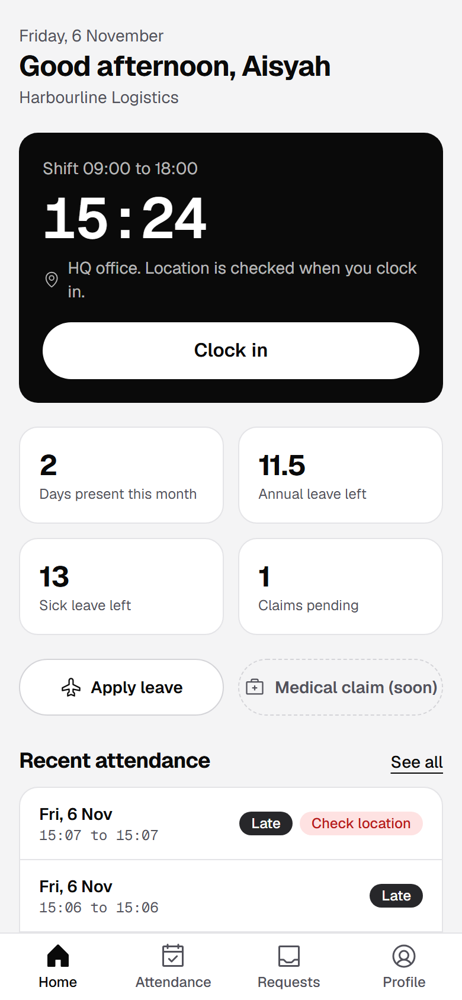
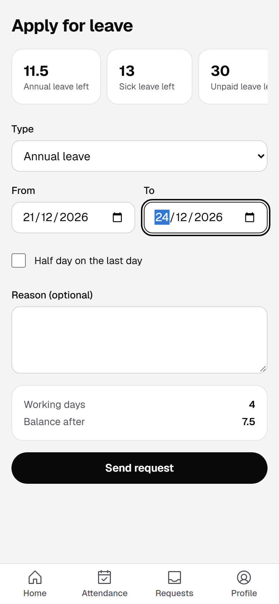
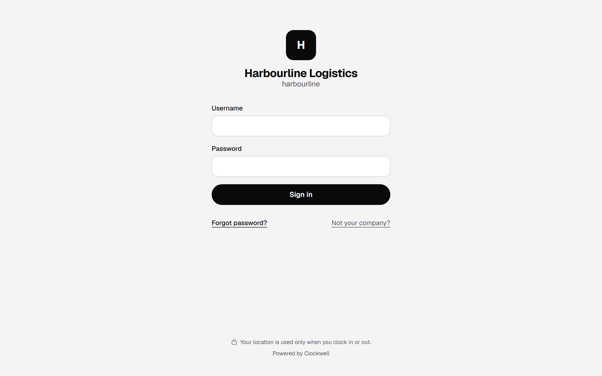
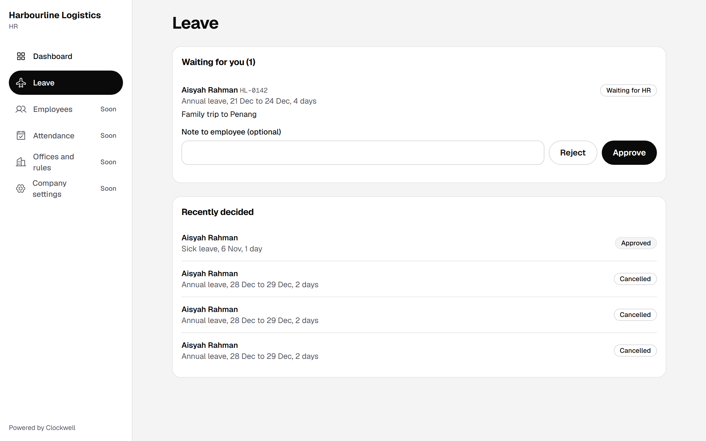

<div align="center">

# Clockwell

**Attendance, leave and claims for small companies, in one simple app.**

Staff clock in with a selfie and their location in under ten seconds.
HR approves leave, checks who is in and fixes attendance from a phone.
Built for Singapore and Malaysia.

`Status: in active development · Phase 1 complete · Phase 2 underway`

</div>

<p align="center">
  
  &nbsp;&nbsp;
  
  &nbsp;&nbsp;
  
</p>

---

## Why Clockwell

Most small and medium companies still run attendance on paper sign-in sheets, punch cards,
WhatsApp messages and spreadsheets. Leave is tracked in someone's inbox. Medical claims sit in a
folder until month end. That costs owners and HR teams hours every week, causes disputes about
who was late, and makes it hard to stay on the right side of the PDPA.

Enterprise HR suites solve this, but they are priced, sized and configured for large companies.
A 20 to 200 person company needs something it can switch on in a day.

**Clockwell is that tool.**

- **No hardware.** No fingerprint scanners or punch-card machines. Staff use the phone they already have.
- **Honest records.** Every clock-in uses the server's time, a selfie and the GPS position, so "my
  phone clock was wrong" stops being an argument.
- **Fair to staff.** Bad GPS or a quick stop on the way never blocks anyone from clocking in. It is
  recorded and flagged for HR to review, not punished automatically.
- **HR from a phone.** See who is in, approve leave and fix a missed clock-out without opening a laptop.
- **Private by design.** Location is read only at clock-in and clock-out. No background tracking,
  no face templates, no biometric data stored.
- **Ready for the region.** Singapore and Malaysia time zones, SGD by default, public holidays per
  company, PDPA-friendly data handling.

## What works today

### For employees (mobile web app)
| Feature | Details |
|---|---|
| Sign in with company address | Each company has its own sign-in page with its name. Staff use a simple username, not an email. |
| Clock in and out | Front camera selfie, live location card showing the nearest site, distance and whether you are inside the zone. |
| Office or home | Hybrid and remote staff choose "Office" or "Home" and are checked against their approved home location. |
| Status at a glance | On time, within grace, or late, worked out from the office shift and grace period. |
| Home dashboard | Live clock, today's shift, days present this month, leave balances, pending claims, recent attendance. |
| Attendance history | Every shift by month, with "Corrected", "Home" and "Check location" badges. |
| Leave requests | Pick a leave type and dates. Weekends and company holidays are skipped automatically, half days supported, and the balance after the request is shown before sending. |
| Requests list | Track every request and cancel one that is pending or has not started yet. |
| Privacy notice | Shown on first sign-in, with the acknowledgement recorded. |

### For HR
| Feature | Details |
|---|---|
| Leave approvals | See every pending request with the reason, approve or reject with a note to the employee. |
| Safe balances | Approving deducts the balance once, inside a locked database transaction, so two clicks can never double-deduct or overdraw. |
| Me / HR switch | HR admins are employees too. One tap switches between their own app and the HR view. |
| Separation of duties | HR cannot approve their own leave. |

<p align="center">
  
</p>

### Built in from day one
- **Multi-company.** Every company's data is isolated by row-level security in the database, and
  automated tests prove that one company can never read another's data.
- **Server time is the record.** The phone's clock is stored only as extra information.
- **No double records.** Every action is safe to retry; a weak connection cannot create two clock-ins.
- **Rate-limited sign-in** that never reveals whether a username exists.
- **Full audit log** of sign-ins, clock events and leave decisions.

## In development

| Coming next | What it does |
|---|---|
| Medical claims | Submit a claim with a receipt photo, checked against the yearly and per-claim limit. HR approves or rejects. |
| Live HR dashboard | "41 of 52 in today", who is late, on leave or not clocked in, and a live feed of clock-ins. |
| Employees | Onboard by invite email, edit, offboard (access removed instantly), seat limits. |
| Attendance corrections | Staff request a time fix; HR adjusts with a reason. The original time is kept for disputes. CSV export. |
| Offices and work rules | Sites on a map radius, shift times, grace period, home days, per-employee overrides. |
| Company settings | Logo and name, data retention, two-step sign-in for HR, time-limited support access. |
| Installable app | Add to home screen, works offline for clock-in and sends when back online, update banner. |
| Reminders | Push reminders to clock out, automatic absence marking, leave year roll-over. |
| Vendor console | Manage companies, plans, modules, feature flags and releases. |

Later: passkey sign-in (Face ID / fingerprint, kept on the phone), payroll export, Malay and Chinese.

## How it is built

| Part | Technology |
|---|---|
| Web app | Next.js (static export), React, TypeScript (strict), Tailwind CSS |
| Data and auth | Supabase: Postgres with row-level security, Auth, Storage, Edge Functions (Deno) |
| Validation | Zod schemas shared between the app and the server |
| Hosting | Vercel |
| Quality | Vitest, Deno tests, pgTAP database tests, Playwright end-to-end tests, GitHub Actions CI |

```
apps/web/          Mobile-first web app (employee and HR)
packages/shared/   Business rules shared by app and server: clock-in rules, leave days, error codes, schemas
supabase/          Database migrations, security policies, Edge Functions, database tests, seed data
e2e/               End-to-end browser tests
docs/              Runbook and screenshots
```

The rules that matter (on time or late, inside or outside a site, working days for leave) live in one
place, `packages/shared`, and run identically in the browser and on the server.

### Test coverage today
- 24 unit tests for the shared rules (time zones, grace edge, distance, leave days, schemas)
- 22 server tests for clock-in and leave decisions
- 74 database tests for tenant isolation, storage access and balance locking
- 8 end-to-end browser flows, including sign in, clock in and out, and leave approval

## Run it locally

You need Node 20+, pnpm 9, Docker Desktop (running) and Deno 2.

```sh
pnpm install
pnpm exec supabase start                  # local database, auth and storage in Docker
cp .env.example apps/web/.env.local       # paste the publishable key printed above
pnpm exec supabase db reset --local       # local only: creates the schema and sample data
pnpm functions                            # Edge Functions (keep running)
pnpm preview                              # app on http://localhost:3000
```

Open `http://localhost:3000/login/?company=harbourline` and sign in with a sample user:
`aisyah` (employee) or `meiling` (HR). Sample passwords are in `supabase/seed.sql` and work on
the local database only.

Checks:

```sh
pnpm lint && pnpm typecheck && pnpm test
pnpm exec supabase test db
deno test --config supabase/functions/deno.json supabase/functions
pnpm e2e
```

More detail is in [docs/RUNBOOK.md](docs/RUNBOOK.md).

## Team

Clockwell is designed and built by

- **[@Jeff-rey13](https://github.com/Jeff-rey13)**
- **Aarif** ([@Aarif-8](https://github.com/Aarif-8))

Interested in Clockwell for your company? Open an issue on this repository or reach out to us on GitHub.

## Licence

Copyright © 2026 the Clockwell team. All rights reserved.
The source is visible for evaluation. It may not be copied, modified or used commercially without
written permission.
